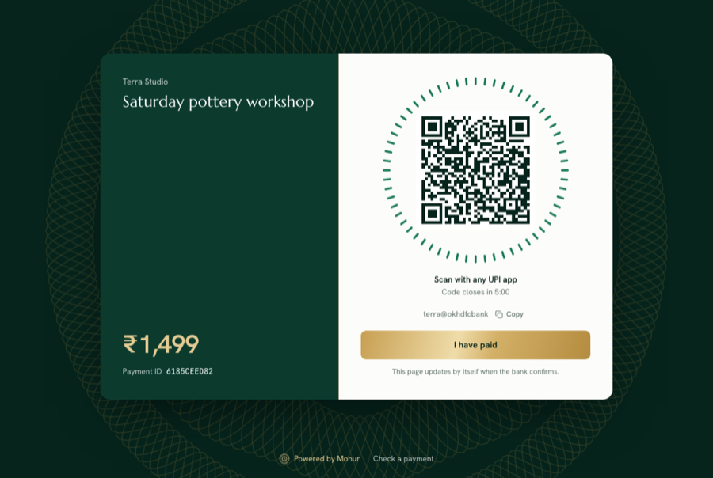
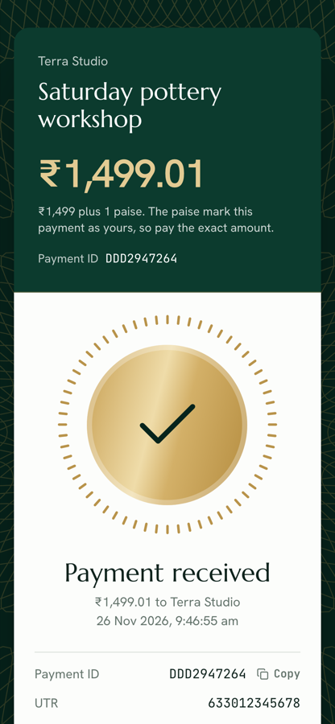
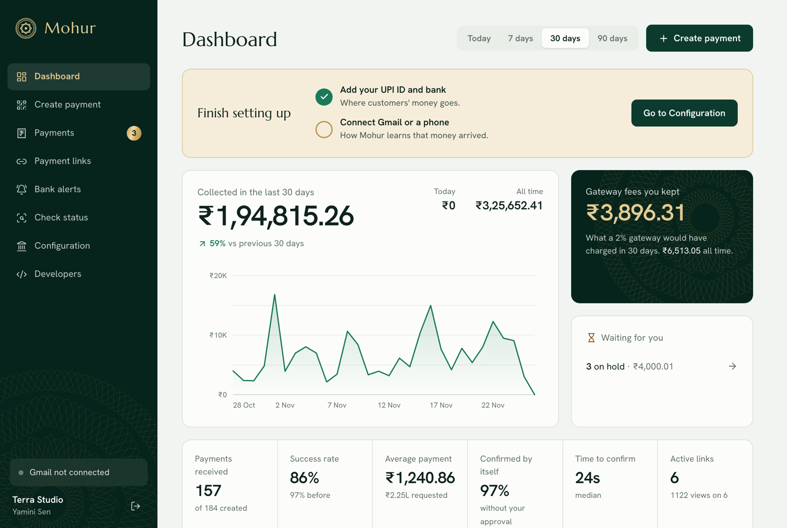

<p align="center">
  
</p>

<p align="center">
  <a href="LICENSE"></a>
  <a href="https://github.com/ashusoni-eng/mohur/stargazers"></a>
  <a href="https://mohur.sanjeevaniprime.com"></a>
  <a href="https://mohur.sanjeevaniprime.com/install"></a>
  <a href="CHANGELOG.md"></a>
</p>

# Mohur

**Open source · 100% free · MIT licence**

**Stop paying 2% on every UPI payment.** Customers pay straight to your own UPI ID. Mohur reads your bank's credit
alert, from Gmail or from SMS on a paired Android phone, and marks the payment paid in seconds. No gateway, no fees,
no one holding your money. (A *mohur* was the gold coin of the Mughal mints.)

> On ₹10 lakh a month, a 2% gateway takes **₹2.4 lakh a year**. Mohur takes nothing.

If Mohur saves you fees, **please star the repo**. It is how other businesses find it.

**New in 1.1:** several UPI accounts with limits and rotation, a test mode with simulated payments, lookups by your own
order number, safe redirects, ordered webhooks, your own colour and logo on checkout, and a public
[API reference](https://mohur.sanjeevaniprime.com/docs). See the [changelog](CHANGELOG.md).

| | Typical payment gateway | Mohur |
|---|---|---|
| Fee per UPI payment | about 2% | **₹0** |
| Where money goes | Gateway, then settled to you | **Straight to your bank** |
| Who holds your data | The gateway | **You** (self-host) |
| Code | Closed | **Open, MIT** |

## Features

- **Payment links and QR codes**: fixed or open amounts, each customer gets their own QR.
- **Confirms by itself**: from your bank's Gmail alert or SMS, usually within seconds, with a live checkout page.
- **Forged receipts never count**: mail must pass Gmail's DKIM/DMARC from your bank; SMS must come from its registered sender.
- **On hold, never lost**: payment ID, UTR entry, manual approve and decline, re-read Gmail on demand.
- **Dashboard**: collections, success rate, fees saved, busiest hours, needs-review queue.
- **Android app** for bank SMS, with on-phone filtering so OTPs never leave the phone.
- **Several UPI accounts**: spread payments across banks with default-first or random rotation, and daily or monthly limits per account.
- **Test mode**: `mhr_test_` keys create payments that carry no money, with simulated paid, on-hold, declined and expired outcomes.
- **Developer API and signed webhooks**: idempotent payment creation, lookup by your own order number, `upi_intent` links, event IDs and per-payment sequence numbers. Full reference at `/docs`.
- **Safe redirects**: limit `redirect_url` to your own domains.
- **Your checkout, your brand**: your colour and logo on checkout and payment-link pages.
- **Many businesses on one server**, each able to delete its account permanently.

<p align="center">
  
  
  
</p>
<p align="center"></p>

TypeScript, Next.js 16, React 19, Tailwind 4, SQLite. Android app in Kotlin.

## Open source and free

Mohur is open source under the [MIT licence](LICENSE). It costs nothing: no fees, plans or limits, for personal or
commercial use.

- **Your money stays yours.** Customers pay your own UPI ID. Mohur never holds or moves money.
- **Host it yourself.** Clone it and run it on your own server, so your payments, settings and Gmail access stay with you.
- **Check it.** Every line is public, including exactly how a bank alert is trusted and matched (see below).

Accounts on a shared server can be deleted permanently by their owner at any time (Configuration → Account); everything
in them is erased, and nightly backups age out after 14 days.

Like any software, it comes with no warranty. Test it with a ₹1 payment before relying on it, and keep it updated.

## Self-host

```bash
git clone https://github.com/ashusoni-eng/mohur.git
cd mohur
npm ci && npm run build
cp .env.example .env   # set APP_URL and APP_SECRET
npm start              # put it behind nginx or Caddy with https
```

Then create your account, add a UPI account, and connect Gmail or pair your Android phone.

## Run locally

```bash
npm install
npm run dev        # http://localhost:4100
npm run seed       # optional demo account with 60 days of invented payments
npm test
```

For production: set `APP_URL` and `APP_SECRET` (see `.env.example`), then `npm run build && npm start`.

It must run as **one long-lived Node process** on a persistent disk (VPS, Docker, Railway, Render, Fly).
Serverless hosts such as Vercel will not work, because the mailbox listener has to stay connected.
Back up `data/` including `secret.key`: without the key, saved Gmail access and account numbers cannot be read.

## Deploy

Mohur needs **one long-lived Node process** on a server with a persistent disk (a VPS, Docker, Railway, Render or Fly).
Serverless hosts such as Vercel will not work: the mailbox listener and payment clocks must keep running, and the database is a file.

```bash
npm ci && npm run build
APP_URL=https://pay.example.com npm start   # behind a reverse proxy with https; see .env.example
```

Back up `DATA_DIR` (the database and `secret.key`) and keep the process on loopback behind nginx or similar.

### Upgrading from 1.0

Back up `DATA_DIR`, then pull, `npm ci && npm run build`, and restart. The database upgrades itself on first start,
in one transaction:

- Your UPI ID and bank details become your first UPI account, marked default. Nothing else changes until you add more.
- Existing API keys (`mhr_…`) keep working as **live** keys, and existing webhook endpoints receive live events.
- `PUT /api/settings/bank` is gone; manage accounts under Configuration → UPI accounts, or `/api/upi-accounts`.
- Webhook bodies gain `sequence` and `livemode`, and payment objects gain `note`, `livemode`, `customer.email` and
  `upi_intent`. Receivers that ignore unknown fields need no change.

## Set up

1. Create an account.
2. Configuration → UPI accounts: UPI ID, account number, IFSC, bank, branch, and optional daily or monthly limits. Add more accounts to rotate between them.
3. Configuration → Gmail: the address your bank mails, plus a Google
   [app password](https://myaccount.google.com/apppasswords). Or set `GOOGLE_CLIENT_ID` / `GOOGLE_CLIENT_SECRET`
   for a "Continue with Google" button (Gmail API, `gmail.readonly`, redirect URI `{APP_URL}/api/mail/google/callback`).
4. Configuration → Alert Lab: paste a real alert from your bank and check that it is read correctly.
5. Send yourself ₹1 and watch it settle.
6. Optional: Configuration → Checkout look for your colour and logo, and Developers → Allowed redirect domains
   before you use the API.

**Check first that your bank emails you for every UPI credit.** Some send only SMS, or only above a minimum amount.
Pair a phone (below) to cover that. With neither alert, payments stay on hold for you to approve.

## Developer API

Full reference with curl, Node.js, PHP and Python examples: **`/docs`** on your server
([live copy](https://mohur.sanjeevaniprime.com/docs)).

Start with a **test key** (Developers → API keys → Test). Test payments show no UPI ID, are never matched to your bank,
stay out of your dashboard, and only reach test webhooks. Move them yourself:

```bash
curl $APP_URL/api/v1/payments -H "Authorization: Bearer mhr_test_..." -H "Content-Type: application/json" \
  -d '{ "amount": 49900, "title": "Order 1042", "reference": "order-1042" }'

curl $APP_URL/api/v1/payments/order-1042/simulate -H "Authorization: Bearer mhr_test_..." \
  -H "Content-Type: application/json" -d '{ "outcome": "paid" }'
```

Swap in a `mhr_live_` key when ready. A few things worth knowing:

- `GET /api/v1/payments/{id}` takes Mohur's payment ID or your own `reference` (newest wins).
- `upi_intent` in the response opens the customer's UPI app directly, while the payment can still be paid.
- Once you list redirect domains, any other `redirect_url` is refused with `422 redirect_not_allowed`.
- Webhooks carry `mohur-event-id` (the same in every retry: deduplicate on it) and `mohur-sequence` (counts up per
  payment: ignore anything lower than what you already applied), signed in `mohur-signature`.

## How a payment moves

```
pending ──customer taps "I have paid"──▶ verifying ──60 s, no mail──▶ on_hold ──▶ paid / declined
   └────────────── bank mail at any point ──────────────▶ paid
   └── never claimed, matching window over ──▶ expired
```

- The 60-second clock starts at "I have paid" by default. Configuration → Payment rules can start it when the QR appears.
- Browsers get status over server-sent events, with a 5-second poll as a fallback.
- A held payment the customer says they paid is also looked for again: Gmail is re-read when it goes on hold and every two minutes for twenty. **Check mail again** on a payment, or on Bank alerts, does it on demand.
- A held payment keeps listening (60 minutes by default). The customer can submit a UTR, and the merchant can approve or decline.

## How a mail is trusted

1. **Headers only.** Subject must look like a credit alert. Otherwise the body is never downloaded.
2. **Sender.** Exact bank domain, and Gmail's own topmost `Authentication-Results` must show aligned DKIM or DMARC. Forgeries go to Bank alerts → Suspicious.
3. **Body.** One unambiguous completed credit. Debits, refunds, offers, pending and failed transfers, or two different amounts are refused.
4. **Match.** The credit is into the UPI account the payment was issued for (bank and last digits agree), UTR unused, and the amount equals exactly one open payment created before the mail. Equal amounts in flight are told apart by paise, and an amount stays reserved until its window ends.

Anything short of that waits for a person under Bank alerts → Needs review.

## Phone app (bank SMS)

`mobile/` is a native Android app (Kotlin, about 1 MB, Android 8+). It wakes for each SMS, even when closed, and sends
bank credit messages to your server. Offline messages are kept and sent later with their original arrival time.
iPhones do not let apps read SMS.

1. Install it on the phone whose number is registered with your bank. Connect it by USB with USB debugging on, then:

   ```bash
   adb install -r public/download/mohur.apk
   ```

   It can also be downloaded from Configuration → Phone (SMS), but Google Play Protect often blocks downloaded apps that read
   SMS, especially in India. Google Play itself does not accept apps like this one.
2. Configuration → Phone (SMS) → Show pairing code, and scan it in the app.
3. Allow SMS. If Android greys it out: tap Allow in the app once, then App info → ⋮ → Allow restricted settings → Permissions → SMS. Or grant it
   over USB with `adb shell pm grant in.mohur.app android.permission.RECEIVE_SMS` (and `READ_SMS`). `/install` on your site has every step.
4. Tap Fix if the app offers to turn off battery saving. On Xiaomi, Oppo, Vivo and Realme also turn on Autostart.

The phone must be able to reach the server. With `APP_URL=http://localhost:4100` the code uses this computer's Wi-Fi address, so
it works on the same Wi-Fi only. For real use, host Mohur on https.

**What is trusted.** Only your bank's registered sender (for example `VM-HDFCBK-S`), never a phone number, and never promotional
(`-P`) messages. OTPs and personal messages are dropped on the phone. Requests are signed with a key that is shown once in the
pairing code and then kept in the phone's keystore. SMS has no equivalent of DKIM, so it is the weaker of the two channels: keep the
bank selected (not "Any supported bank") and the account number filled in, so the last digits are checked too.

**Same credit twice.** Mail and SMS for one credit count once: by UTR, or by the reserved amount when one of them leaves the UTR out.

Build and test (needs JDK 17+ and Android SDK 35; set `sdk.dir` in `mobile/local.properties`):

```bash
cd mobile && ./gradlew testDebugUnitTest assembleRelease
```

Back up `mobile/mohur-release.jks` and `mobile/keystore.properties`. They are not in git, and without them you cannot ship an update
that installs over the old app. Copy a new build to `public/download/mohur.apk`.

## Layout

| Path | What |
|---|---|
| `src/lib/server/mail/` | `screen` (headers), `parse` (body), `ingest` (matching), `imap`, `google` |
| `src/lib/server/payments.ts` | Payment state machine; `settleInTx` is the only way to become paid; test-mode `simulate` |
| `src/lib/server/accounts.ts` | UPI accounts, rotation and daily or monthly limits |
| `src/lib/server/webhooks.ts` | Payment object, event sequence, signed delivery with retries |
| `src/lib/server/brand.ts` | Checkout logo and colour checks |
| `src/lib/server/devices.ts`, `mail/sms.ts` | Paired phones and SMS intake |
| `mobile/` | Android app |
| `src/lib/server/engine.ts` | Mailbox listeners, clocks, webhook sender |
| `src/app/api/v1` | REST API |
| `src/app/docs` | Public API reference |
| `src/lib/banks.ts` | Trusted bank domains |

## Limits

- UPI only, ₹1 to ₹1,00,000 per payment. No refunds: Mohur cannot move money.
- Bank domains, SMS senders and alert wording vary and change. Test yours in Alert Lab before relying on it.
- Collect only into your own account. Collecting on behalf of others in India needs an RBI payment aggregator licence.
- No direct Paytm, PhonePe or Google Pay verification. Their official status APIs work only after you are onboarded as their
  gateway or enterprise customer (usually with a gateway fee), and only for payments made through their own merchant IDs.
  Mohur will not use unofficial or scraped endpoints. Your bank's alert stays the free, provider-neutral source of truth.

## Contributing

Pull requests are welcome, especially **new bank email and SMS formats**: see [CONTRIBUTING.md](CONTRIBUTING.md) and the
issues labelled *good first issue*.
